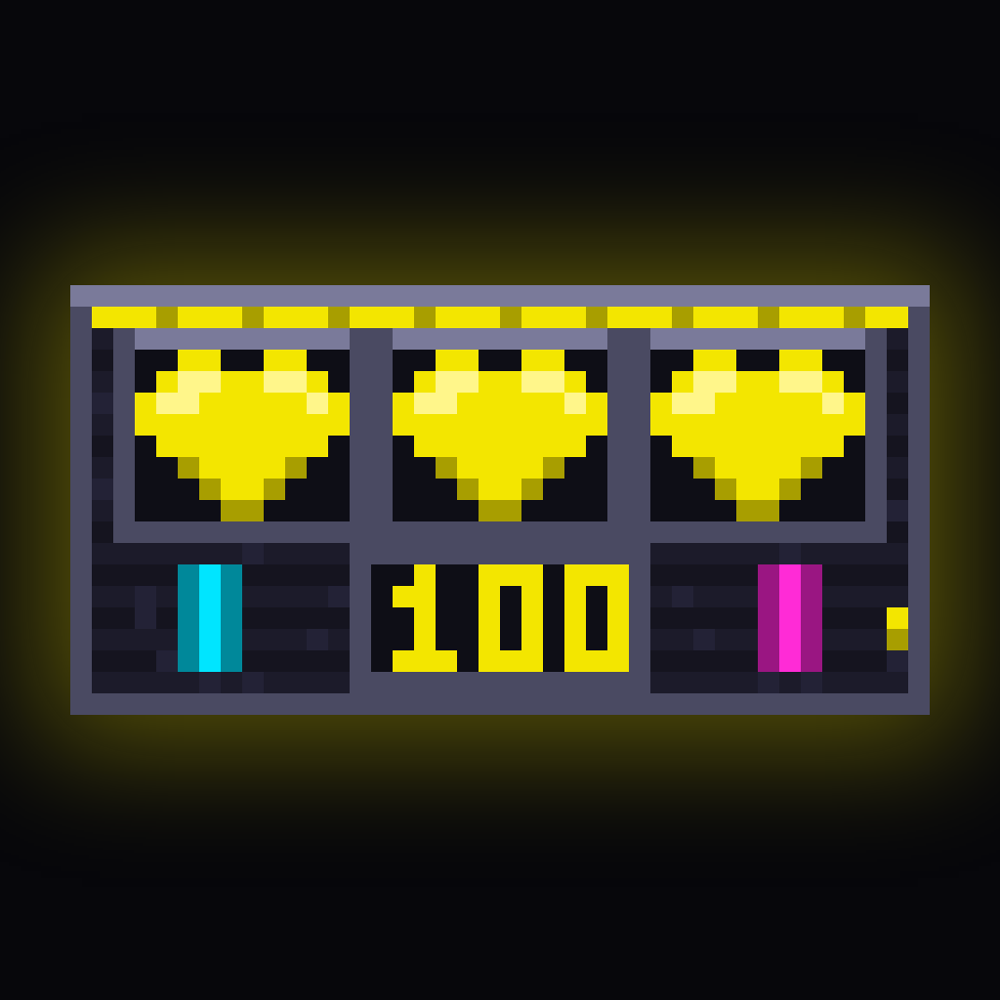

# Claude Slots

A Claude Code plugin that pins a small pixel-art slot machine in a neon
cyberpunk style to the bottom-right of the screen, just above the prompt.
Every prompt pulls the trigger,
the reels keep turning for as long as Claude works, and when the turn ends
they land on your outcome: you might win a **FEATURE**, a **CLIENT**, or
**A LIFE**.

<p align="center"></p>

What you see at the bottom-right of the screen (40 columns × 10 rows,
truecolor half-block pixels; idle between turns, turning during one):

- three reels scrolling an eight-symbol strip: an optic implant (FEATURE), a
  banknote (CLIENT), a casino token (LIFE), and five fillers (pills, a
  pistol, a fixer, a deck, a blade), with grain flicker and scanlines on
  the cabinet
- the credit balance, and nothing else: no verbs, no timers, no token counts

When the turn completes the reels stop left to right, an outcome overlay
flashes, and the turn's closing line in the transcript reads like

```
◈ no match  −1 cr  balance 096
◈ CLIENT  +19 cr  balance 119
```

Interrupting a turn (Esc) or an API error jams the machine, refunds the spin
and shows `INTERRUPTED · refunded` / `MALFUNCTION · refunded` under the
prompt for three seconds.

## Requirements

- Claude Code **2.1.287 or newer** (mods are on by default; no environment
  variable). Validated against 2.1.316.
- A terminal with truecolor and a font that draws `▀` (U+2580) with full-cell
  coverage: iTerm2, Terminal.app, VS Code's terminal, kitty, WezTerm all do.
- At least 40 columns. Narrower viewports get a one-line readout
  `[ ◈ SPINNING · 097 cr ]` instead of the sprite.

The plugin has **zero runtime dependencies**. Remotion (used to author the
art) lives only under `art/` and is never loaded by Claude Code.

## Install

### From GitHub (recommended)

```
/plugin marketplace add WorldInnovationsDepartment/claude_slots
/plugin install slots@slots-local
```

### From a local checkout

```bash
git clone https://github.com/WorldInnovationsDepartment/claude_slots.git
claude --plugin-dir /path/to/claude_slots
```

or register the checkout as a local marketplace:

```
/plugin marketplace add /path/to/claude_slots
/plugin install slots@slots-local
```

The machine sits above the prompt from the first draw; submit any prompt
and the reels start turning. `ctrl+x ctrl+a` collapses the band if you
want it out of the way.

## Commands

| Command | What it does |
| --- | --- |
| `/slots:demo [life\|client\|feature\|lose\|aborted\|error\|spinning]` | Plays one spin (or loops one phase) in the transcript using the same engine and sprite sheet, without touching your credits. |
| `/slots:stats` | Prints balance, spins, wins by class, streaks and the last three outcomes from the persisted store. Read-only. |

Both can be run directly: `node bin/demo.js --outcome=life`,
`node bin/claude-slots-stats.js`.

## Options

Set under the plugin's `userConfig` (Claude Code's plugin settings UI, or the
`pluginConfigs` block of your settings):

| Option | Default | Meaning |
| --- | --- | --- |
| `startCredits` | `100` | Balance a brand-new install starts with (0 to 100000). |

## The economy

| Outcome | Probability | Pays | Net per spin |
| --- | --- | --- | --- |
| A LIFE (♥ ♥ ♥) | 1 % | 100 | +99 |
| CLIENT (💼 💼 💼) | 4 % | 20 | +19 |
| FEATURE (◆ ◆ ◆) | 10 % | 5 | +4 |
| no match | 85 % | 0 | −1 |

Each prompt costs 1 credit, charged when the spin starts. At 0 credits the
spin still runs, costs nothing, and the result line says `on the house`.
Interrupted and errored turns are refunded and count as neither win nor loss.
Balance and statistics persist across sessions in the plugin's key-value
store under `slots.economy`. Outcomes are rolled once per turn
from a seed of session id, turn count and time, so the reels always land on
the outcome that was decided when the spin started.

## Upgrading from `claude-slots` (the old name)

Version 0.x was called `claude-slots`. Claude Code 2.1.316 refuses that name
(the `claude-` prefix is reserved), so the plugin was renamed and old installs
no longer load; you will see a dim `claude-slots: hooks module did not load`
line until you remove it:

```
/plugin uninstall claude-slots@claude-slots-local
/plugin marketplace remove claude-slots-local
```

The old **Tier 2** statusline fallback (`/claude-slots:setup`,
`/claude-slots:teardown`, `bin/claude-slots-statusline.js`) is gone: mods are
on by default now, so there is nothing for it to fall back from. If you ran
the old setup, delete the `statusLine` entry it wrote from
`~/.claude/settings.json` (the setup script left a `*.claude-slots.bak-*`
backup beside it). Old credits were stored under a different key and are not
migrated; a fresh install starts at `startCredits`.

## Repository layout

```
.claude-plugin/     plugin.json, marketplace.json, icon.png
hooks/hooks.json    "modules": ["./slots.js"]
hooks/slots.js      the mod: the only file that touches `$` / `on` / `next`
lib/
  machine.js        time-driven state machine: phases, reel offsets, result line
  sprite-frame.js   sheet + state -> Frame of ▀ cells (both colours always set)
  sprites.json      the sprite sheet (built, committed, ≤ 400 KB)
  sprites.js        the same sheet as a module (the mod loader imports code only)
  symbols.js        symbols, probabilities, payouts (mirrors docs/ART-SPEC.md)
  rng.js            seeded outcome roll
  economy.js        credits, payouts, refunds
  frame.js, render-tree.js, render-ansi.js, width.js
  mod-helpers.js    pure helpers for hooks/slots.js (testable from Node)
bin/demo.js         terminal demo player (ANSI, 10 fps)
bin/claude-slots-stats.js
commands/           /slots:demo, /slots:stats
art/                the Remotion project: single source of the machine art + launch video
scripts/dev/
  build-sprites.js  art/ -> lib/sprites.json + lib/sprites.js + docs/sprites-contact.png
  make-music.js     synthesizes the launch video's soundtrack (no licensed audio)
  pty-smoke.py      live verification in a real terminal
docs/               ARCHITECTURE.md, ART-SPEC.md, sprites-contact.png, launch.mp4, review/
tests/              node --test
```

## Development

```bash
claude plugin validate .          # manifest, marketplace and mod module: must pass with zero errors
node --test tests/*.test.js       # engine, sprite sheet, economy, rng, renderers
node bin/demo.js --outcome=life   # watch a spin in your terminal
```

### Rebuilding the sprite sheet

The art is authored once, in `art/src/machine/`, as a Remotion composition.
The terminal sprite sheet and the launch video are two renders of it. After
changing anything there:

```bash
cd art && npm install && cd ..          # once; installs Remotion + its headless Chromium under art/
node scripts/dev/build-sprites.js       # renders every layer, quantises to the 24-colour palette
node --test tests/*.test.js             # the sheet tests guard geometry, palette, seams, overlays
```

The build is deterministic (two runs produce byte-identical `lib/sprites.json`)
and refuses any pixel that is not exactly in the palette. If Chromium cannot
be downloaded, pass `--browser-executable=<path>`.

`docs/sprites-contact.png` is a contact sheet of every layer for review, and
Remotion Studio shows the components live:

```bash
cd art && npx remotion studio src/index.ts
```

### Rendering the launch video

```bash
node scripts/dev/make-music.js                                   # -> art/public/launch-track.wav (synthesized, offline)
cd art && npx remotion render src/index.ts Launch ../docs/launch.mp4 --codec h264 --crf 17 --overwrite
```

The soundtrack script and the `Launch` composition share `art/src/timeline.json`
(BPM, scene starts, reel-stop frames), so the accents land on the reel stops.

### Live verification in a real terminal

```bash
python3 scripts/dev/pty-smoke.py --tui default    --out /tmp/run1
python3 scripts/dev/pty-smoke.py --tui fullscreen --out /tmp/run2
```

Each run drives a real `claude --plugin-dir .` session through a PTY, sends a
prompt, and counts `▀` rows; with `pyte` installed it also reconstructs the
screen twice a second and checks that the 40 × 10 sprite rectangle is fully
painted (no stale transcript text inside it) and disappears after the turn.

## Troubleshooting

- **No machine above the prompt.** Run
  `claude plugin validate .` in the plugin directory and
  `claude --plugin-dir . --debug`; a mod that fails to load prints one dim
  line naming the reason. The most common cause is a Claude Code older than
  2.1.287.
- **Colours look flat or wrong.** The terminal is not advertising truecolor;
  set `COLORTERM=truecolor`. The ANSI demo falls back to 256 colours.
- **Rows of `▀` look like gaps.** The font does not cover the full cell with
  U+2580; switch the terminal font (any of the fonts bundled with the
  terminals listed above work).
- **No result line after an interrupted turn.** Expected: Claude Code draws
  no closing line for aborted turns, so the refund notice goes under the
  prompt instead.

## Uninstall

```
/plugin uninstall slots@slots-local
```

or stop passing `--plugin-dir`. Persisted credits live in
`~/.claude/plugins/store/slots*.json`; delete that file to reset.

## License

MIT.
